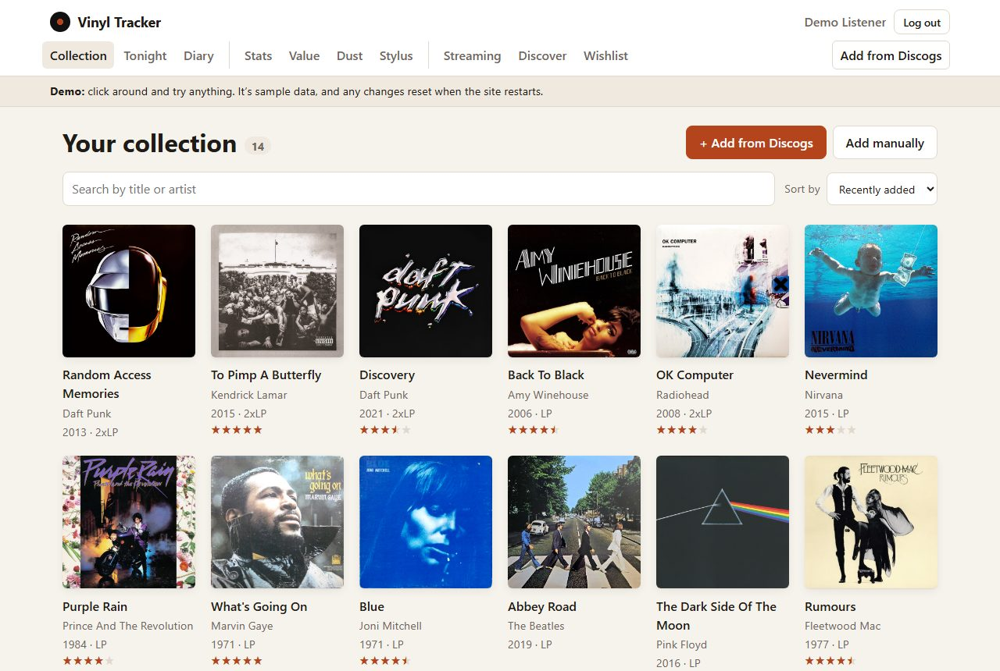
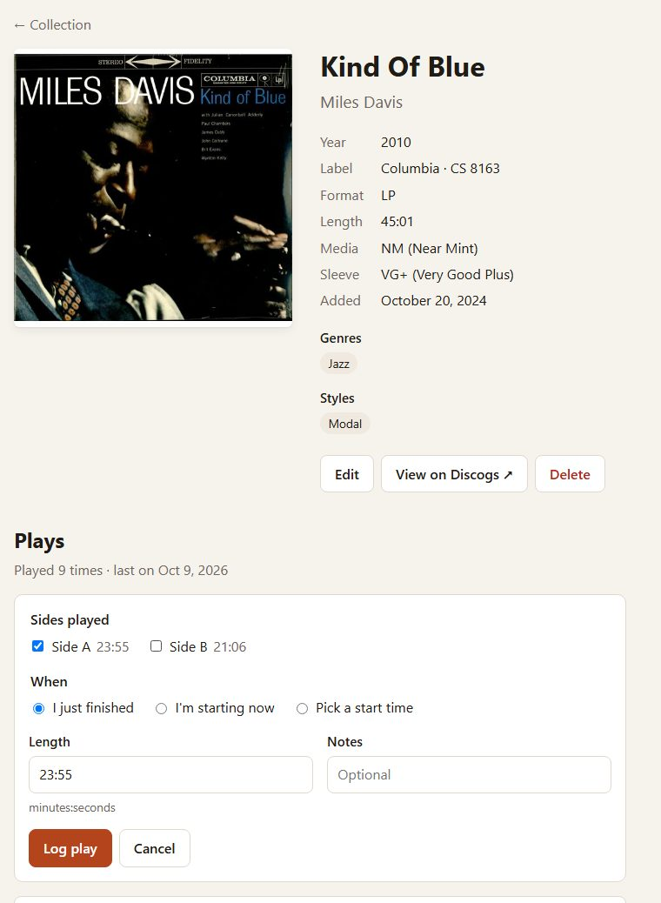
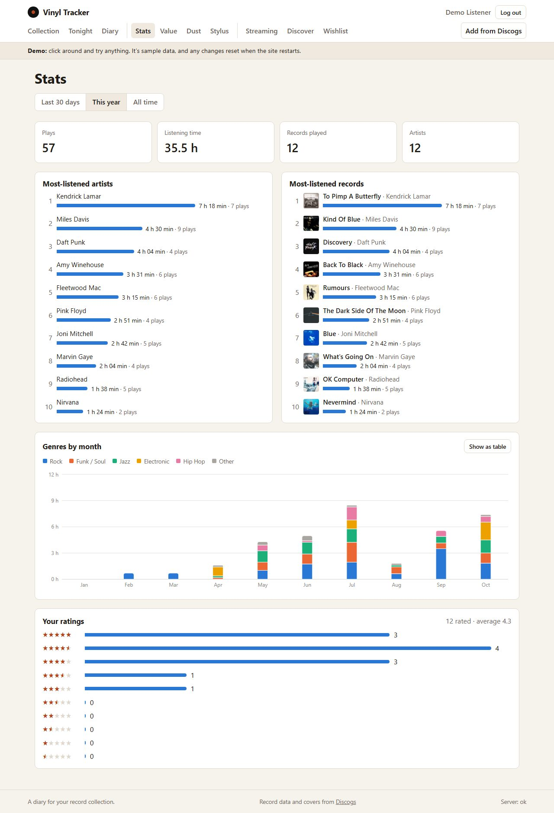
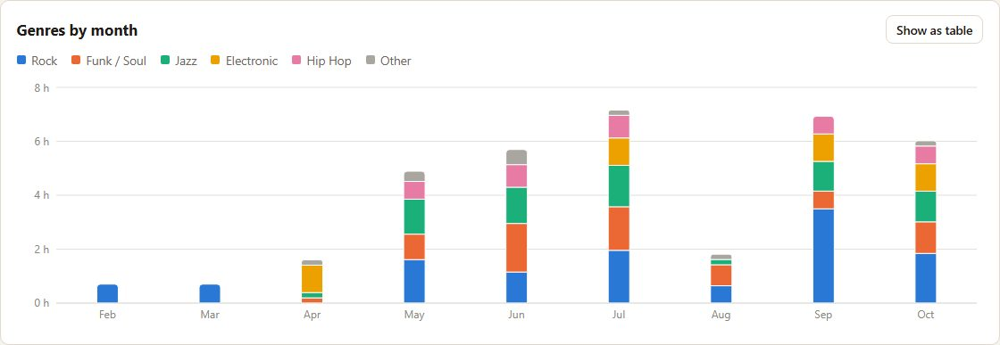
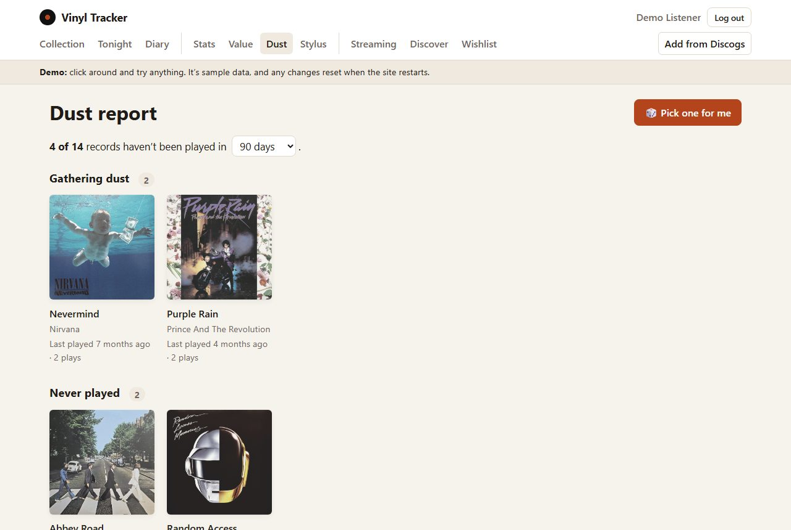
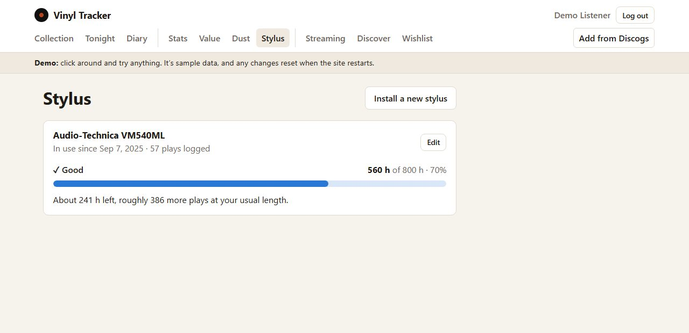
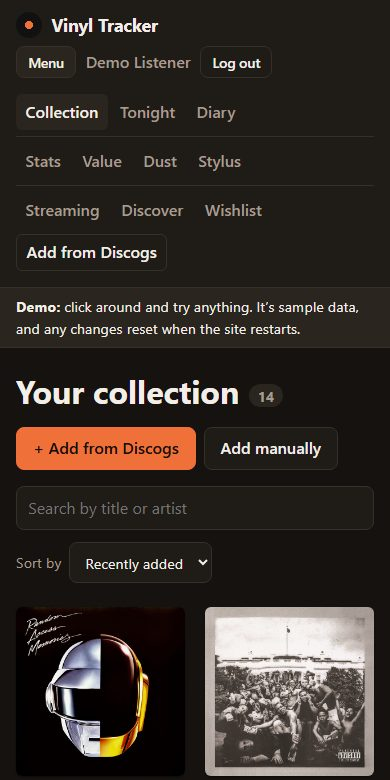

# Vinyl Tracker

[](https://github.com/danielcoria/vinyl-tracker/actions/workflows/ci.yml)

**A diary for your record collection.** Track the vinyl you own, log what you play side by side, and see your listening stats, the records gathering dust on your shelf, and how worn your turntable's stylus is.

### 🔗 Live demo: [vinyl-tracker-qu7q.onrender.com](https://vinyl-tracker-qu7q.onrender.com)

Click **Try the demo** on the login page to open a shared demo account filled with 14 sample albums and about six months of listening, so every page has something to show. Try anything; it resets to the sample data whenever the server restarts. You can also create your own account. To see a public profile without logging in, open [/u/demo](https://vinyl-tracker-qu7q.onrender.com/u/demo).

> **Heads-up:** the demo runs on a free server. After 15 minutes without visitors it sleeps, and the next visit takes about a minute. After that it's fast.



## What it does

- **Accounts.** Sign up with a username and password; everyone gets their own private collection, diary, stats and stylus.
- **Public profiles.** Each account has a page at `/u/username` with its shelf, most-played records and artists, recent plays, and a "year in records" recap for every year. Private until its owner turns it on; notes and record conditions are never shown.
- **Ratings and reviews.** Rate records from half a star to five and write a review; rate individual listens in the diary. Sort the collection by rating, see how the ratings are spread, and share reviews on the public profile (private notes are never shared).
- **"What should I play tonight?"** Say how much time there is, a genre and a mood, and get three picks from the shelf with the reasons: "Never played", "Side A fits your 30 minutes". One click logs the play.
- **Streaming vs. shelf.** Connect a Last.fm username to see the albums streamed most but not owned on vinyl ("streamed 412 times, from $20.98 on vinyl"), with live Discogs prices, and keep a wishlist. The demo uses sample streaming data.
- **Recommendations.** A Discover page suggests albums by artists similar to the ones on the shelf, weighted by what is owned, played and rated most, and explains each one: "Because you own Miles Davis and John Coltrane". With vinyl prices and one-click wishlisting.
- **Collection value over time.** The server looks up what each record sells for on Discogs about once a day and keeps every price, so a chart shows the collection's value over time, how prices have moved, and the records from most to least valuable.

- **Collection.** Search Discogs and add the exact pressing you own in one click (cover, label, catalog number, tracklist, genres), or add records by hand. Search and sort your shelf.
- **Listening diary.** Log each play by side: tick the sides you played (A, B, C…), and the length fills itself in from the tracklist. Every play lands in a diary, grouped by day.
- **Stats.** Most-listened artists and records, plus a chart of how your listening moves between genres month by month. Ranked by listening time, so one side counts for less than a whole double album.
- **Dust report.** Records you haven't played in a while (you choose how long), and ones you've never played. "Pick one for me" opens a random forgotten record.
- **Stylus wear tracker.** Turntable styluses wear out after a few hundred to a thousand-plus hours. Your logged plays add up against the stylus's rated lifespan, and a warning appears when it's time to replace it.

## Screenshots

| Logging a play, side by side                                                                | Listening stats                                                              |
| ------------------------------------------------------------------------------------------- | ---------------------------------------------------------------------------- |
|                           |              |
| **Genres by month**                                                                         | **Dust report**                                                              |
|  |  |
| **Stylus wear**                                                                             | **On a phone, in dark mode**                                                 |
|                                        |    |

## How it's built

| Part         | Technology                                                                                              |
| ------------ | ------------------------------------------------------------------------------------------------------- |
| Website      | React, TypeScript, Vite, React Router, TanStack Query, Recharts                                         |
| Server       | Node.js, Express, TypeScript                                                                            |
| Database     | SQLite (better-sqlite3) with Drizzle ORM and versioned migrations                                       |
| Shared rules | Zod schemas used by both the website and the server, so they always agree on what valid data looks like |
| Outside data | Discogs API (records, covers, tracklists)                                                               |
| Testing      | Vitest, Supertest, React Testing Library, Playwright                                                    |
| Delivery     | Docker, GitHub Actions, Render                                                                          |

```
 Browser ──▶ Website (React) ──/api──▶ Server (Express) ──▶ SQLite database
                                            │
                                            └──▶ Discogs API (token stays on the server)
```

A few decisions worth mentioning:

- **Accounts are built in, not bolted on.** Passwords are stored as scrypt hashes; logins use an httpOnly, SameSite cookie; every query is scoped to the logged-in account, and tests check that one account can never read or change another's data.
- **The Discogs token never reaches the browser.** The website only talks to its own server, which talks to Discogs. It stays under Discogs' limit of 60 requests a minute and remembers recent answers.
- **Derived numbers are never stored.** Play counts, "last played", dust status, stylus wear and stats are all worked out from the diary when asked, so they can't drift out of sync.
- **Plays are saved by start time and by track,** so plays logged later with a past date still count for the right stylus, and song-level stats or Last.fm scrobbling can be added later without reshaping the data.
- **Charts are checked for color blindness.** The chart colors were run through a colorblind-safety checker in both light and dark mode, and every chart has a table view.

## Testing and CI

- **220+ unit and integration tests** cover the server (every API route, against a temporary in-memory database) and the website (screens tested the way a person uses them).
- **6 end-to-end tests** drive a real Chrome browser through the whole app: adding and editing records, importing from Discogs, logging a play and seeing it in the diary and stats, the dust report and the stylus warning. They run against a fake Discogs and a fresh database every time.
- **On every push, GitHub Actions** runs formatting, lint, type checks, all tests and the build on Node 22 and 24, the end-to-end tests, and builds and smoke-tests the Docker image (including that data survives a restart).
- **The live demo only updates after all of those pass.**

## Run it on your computer

You need [Node.js](https://nodejs.org) 22 or newer.

```bash
git clone https://github.com/danielcoria/vinyl-tracker.git
cd vinyl-tracker
npm install
cp .env.example .env            # then add your Discogs token to .env (optional)
npm run db:seed -w server       # optional: some sample records
npm run dev
```

Then open **http://localhost:5173**.

The Discogs token is only needed for "Add from Discogs". You can get one free at [discogs.com/settings/developers](https://www.discogs.com/settings/developers) ("Generate new token"). Everything else works without it.

"Streaming vs. shelf" needs a free Last.fm API key as well: see [Connecting Last.fm](#connecting-lastfm) below. Prices on that page use the Discogs token.

| Command                              | What it does                                        |
| ------------------------------------ | --------------------------------------------------- |
| `npm run dev`                        | Start the website and server, reloading as you edit |
| `npm test`                           | Run the unit and integration tests                  |
| `npm run test:e2e`                   | Run the end-to-end browser tests                    |
| `npm run lint` / `npm run typecheck` | Check the code                                      |
| `npm run build` then `npm start`     | Build and run it the way it runs online             |

## Connecting Last.fm

"Streaming vs. shelf" compares what you stream with what you own, and "Discover" recommends albums; both get their information from Last.fm. There are two separate steps, for two different people:

- **Using the Streaming page** (anyone with an account on the site): enter a Last.fm username. (Discover needs no username: it works from the shelf.)
- **Setting up the server** (whoever runs the site, once): give it a Last.fm API key.

### Using it: connect your Last.fm username

1. **Have a Last.fm account that knows what you listen to.** Last.fm doesn't play music itself; it keeps a history of what you play elsewhere.
   - Create a free account at [last.fm/join](https://www.last.fm/join).
   - Connect your streaming service at [last.fm/settings/applications](https://www.last.fm/settings/applications) (for example "Spotify Scrobbling": click Connect and approve it).
   - From then on, everything you play is added to your Last.fm history. A brand-new account starts empty, so give it a few days of listening before expecting results.
2. **Find your username.** It's the name in your profile's address: `last.fm/user/your_name`.
3. **In Vinyl Tracker, open "Streaming"** in the menu, type the username and click **Compare with my shelf**.

No Last.fm password is ever asked for: the list of someone's most-played albums is public on Last.fm, and the username is all that's needed to read it. To switch accounts or stop, click **Change** next to the username, then **Save** or **Disconnect**.

If the page says the username doesn't exist, check the spelling against your profile's address. If it shows no albums, pick a longer period (a new account has little history).

On the public demo, the "Try the demo" account is connected to a made-up listener (labelled "Sample data"), so the page has something to show.

### Setting it up: give the server a Last.fm API key

This is only for whoever runs the site. The key identifies the app to Last.fm; it isn't tied to anyone's listening.

1. Log in to Last.fm and open [last.fm/api/account/create](https://www.last.fm/api/account/create).
2. Fill in the form:
   - **Application name:** `Vinyl Tracker`
   - **Application description:** a sentence, e.g. "Compares my most-streamed albums with the records I own."
   - **Callback URL:** leave empty
   - **Application homepage:** the site's address (or leave empty)
3. Click Submit. Last.fm shows an **API key** and a **Shared secret**. Only the API key is needed. (Both can be found again later at [last.fm/api/accounts](https://www.last.fm/api/accounts).)
4. **On your computer:** open the `.env` file in the project folder and add a line (no quotes, no spaces):

   ```
   LASTFM_API_KEY=paste-the-api-key-here
   ```

   Stop `npm run dev` (Ctrl+C) and start it again. The server prints `Last.fm: configured` when it has found the key.

5. **On the live site (Render):** open the service's dashboard → **Environment** → **Add Environment Variable**, with the key `LASTFM_API_KEY` and the same value, then save. Render restarts the site by itself.

Like the Discogs token, the key stays on the server: it's never sent to the browser, and `.env` is never committed. Without a key, the page says Last.fm isn't set up (and the demo account still shows its sample data).

## Project layout

```
client/   the website (React)
server/   the server (Express) and the database
shared/   the data rules both sides use
e2e/      end-to-end browser tests
docs/     guides: how it works, and how it's deployed
```

New to the code? **[docs/HOW-IT-WORKS.md](docs/HOW-IT-WORKS.md)** walks through every part in plain language. Deployment details are in **[docs/DEPLOY.md](docs/DEPLOY.md)**.

## What's next

The plan is to grow this into a "Letterboxd for physical music":

- **Scrobbling to Last.fm:** sending vinyl plays logged here to your Last.fm history, so records count alongside streams

## Credits

Record data and cover images come from [Discogs](https://www.discogs.com).
