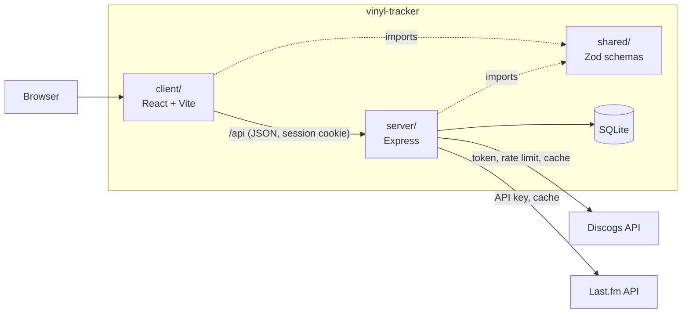
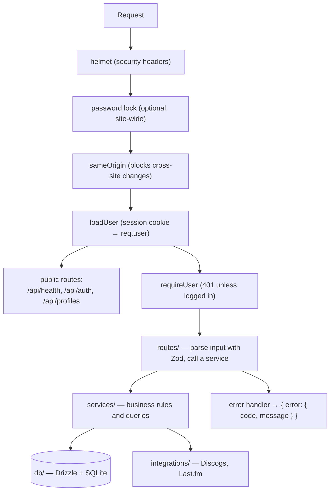
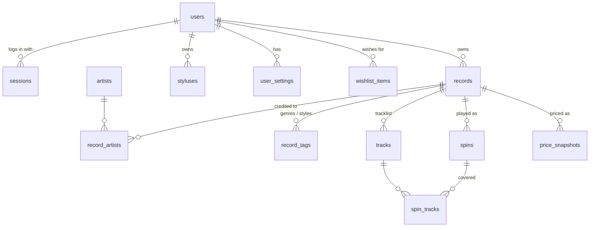
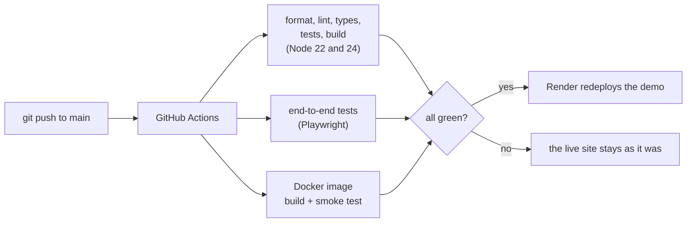

# Architecture

How Vinyl Tracker is put together, and why. For a plain-language tour of every file, see [HOW-IT-WORKS.md](HOW-IT-WORKS.md); for running it online, see [DEPLOY.md](DEPLOY.md).

## The shape of it

One repository, four packages (npm workspaces):

- **`shared/`** holds one Zod schema per API contract. The server validates requests with it; the client validates responses with the same schema and derives its TypeScript types from it. The two sides can't drift apart without a type error or a failing test.
- **`client/`** is a single-page React app. Server data lives only in TanStack Query's cache (no copies in component state), organized by feature folder.
- **`server/`** is an Express app built by a factory, `createApp({ db, discogs, lastfm, ... })`, which takes everything it depends on as arguments. Tests build the same app with an in-memory database and stand-ins for the outside services.
- **`e2e/`** drives the real client and server in a browser, against a fake Discogs/Last.fm.

In production the server also delivers the built client, so there is one process, one port and one origin.

## Inside the server

Requests pass through fixed layers, each with one job:

Rules that keep it honest:

- **Routes never touch the database**, and **only `integrations/` talks to the outside world**. A route parses, calls one service function, and sends the result.
- **Every service function takes a `userId`** and filters by it. Asking for someone else's record answers 404, never 403, so ids don't reveal what exists. `test/isolation.test.ts` has two accounts trying to reach each other's data through every route.
- **Errors are values with a code.** Services throw `AppError(status, code, message)`; one handler turns them (and Zod failures) into `{ error: { code, message } }`. The client shows `message` and branches on `code`.
- **Only `config.ts` reads the environment.** Everything else receives plain values, which is what makes the app factory testable.

## The data model

- A **spin** is one play: the record, when it _started_, how long, and which sides. `spin_tracks` records the tracks it covered.
- **Ownership is one hop.** Records and styluses belong to a user; tracks, spins and price snapshots belong to whoever owns their record. Deleting a record cascades.
- **Spins have no stylus column.** A stylus's wear is the sum of spins whose start time falls between its install and retire dates, so a play logged later with a past date still lands on the right stylus.

## Decisions, and what they cost

**SQLite, synchronously.** One file, no database server, and `better-sqlite3` is synchronous, so services read top to bottom with ordinary transactions. It fits a personal collection (thousands of rows, not millions) and makes tests trivial (`:memory:`). The cost: one writer at a time and one machine. If this ever needed several servers, the service layer is where a different database would plug in.

**Derived values are computed, never stored.** Play counts, last-played dates, dust status, stylus wear, stats, the ratings spread and the collection's value are all worked out from the stored facts when asked. Nothing can drift out of sync, and back-dated or deleted plays are automatically right everywhere. The cost is recomputing on each request, which is negligible at this size; some of the adding-up is done in TypeScript rather than SQL because it is easier to read and test.

**Sessions, not tokens.** A random token in an httpOnly, SameSite=Lax cookie; only its SHA-256 is stored, so a copy of the database can't be replayed as a login. Passwords are scrypt hashes with the parameters stored alongside. State-changing requests must come from the site's own origin. Logging in is rate-limited per address, and a wrong username and a wrong password get the same answer.

**Outside services are treated as unreliable and metered.**

- Secrets stay on the server; the browser only ever calls `/api`.
- The Discogs client enforces their 60-requests-a-minute limit itself and caches answers (searches for minutes, releases for a day, prices for hours); the Last.fm client caches for an hour to a day.
- Work that fans out is bounded: a price lookup compares at most three pressings; the pages auto-load only the first few prices and offer "Check price" for the rest; collection prices are refreshed in the background at 15 records per 10 minutes.
- Their failures become specific error codes, partial failures are tolerated where the result is still useful (recommendations), and nothing is ever written as "no result" when the truth is "couldn't ask".

**Explainable picks.** "What should I play tonight?" and the recommendations are deterministic scoring over data the app already has (dust, ratings, fit, similarity), and every result carries the facts behind it so the page can say why. There is no randomness to debug and nothing to tune in the dark; "Shuffle" just asks again, excluding what was shown.

**Public profiles share by construction.** The profile service builds its answer by copying named, shareable fields; notes, conditions, the stylus and settings are never in the object to begin with, and a test checks the JSON for them. A private profile and a missing username return the identical 404.

**Editions are not the same album.** Matching streamed albums to the shelf uses two keys: an exact one (same album and edition) that counts as "owned", and a looser one (edition labels stripped) that is only shown as "you own a different edition". Collectors may want both.

## Testing

| Layer            | Tool                           | What it proves                                                                                      |
| ---------------- | ------------------------------ | --------------------------------------------------------------------------------------------------- |
| Server           | Vitest + Supertest             | Every route and service, through the real app, on an in-memory database                             |
| Outside services | Recorded fixtures              | The clients parse real Discogs and Last.fm answers; tests never use the network or need keys        |
| Website          | Vitest + React Testing Library | Whole pages rendered inside the app, used the way a person would, with a fake `/api`                |
| Whole app        | Playwright                     | Real browser, real server, fresh database, fake Discogs/Last.fm; each test signs up its own account |
| Isolation        | A dedicated suite              | One account can never read or change another's data                                                 |

Time is injected (`now` parameters) wherever a result depends on it, so tests for dust, stylus wear, suggestions and price history use fixed clocks instead of sleeping.

## Delivery

The Docker smoke test starts the real image, signs up, saves a record, restarts the container and checks the record survived. The public demo runs in `DEMO_MODE`: it seeds itself with sample data on start (deterministically, from a seeded random-number generator) and labels anything that isn't real.

## Known limits

- **No email**, so no password reset and no account recovery.
- **One currency** per collection value: prices in other currencies are left out rather than converted.
- **Price history starts when tracking starts**; Discogs offers no past prices.
- **The free demo host has no persistent disk**, so the demo resets when it sleeps. The Docker image supports a real volume.
- **Single turntable** assumed for stylus wear.
